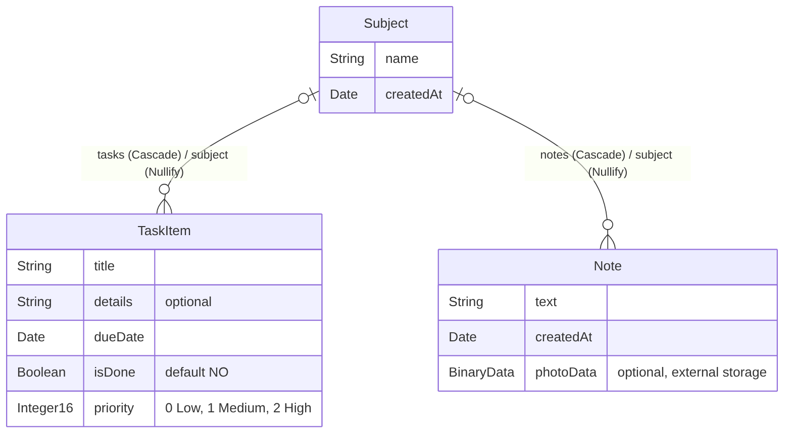
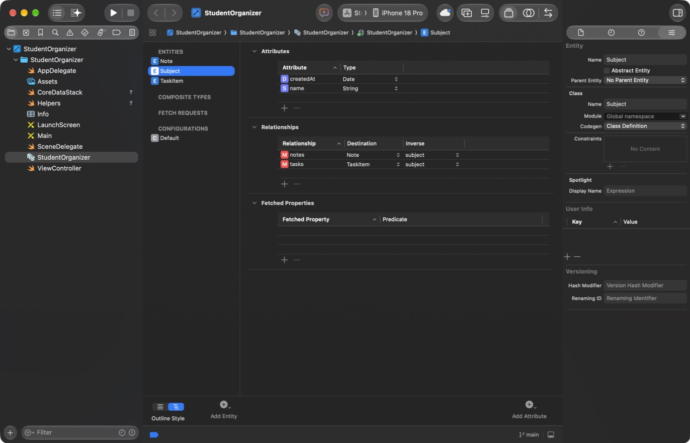
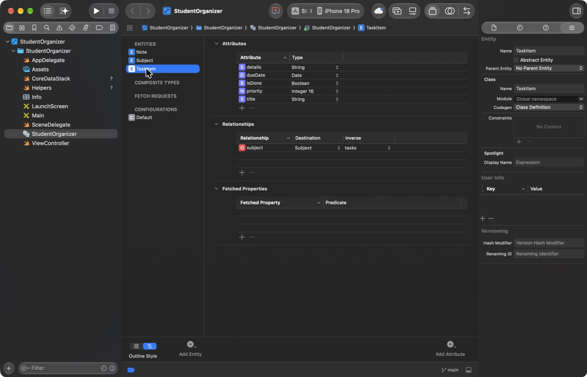
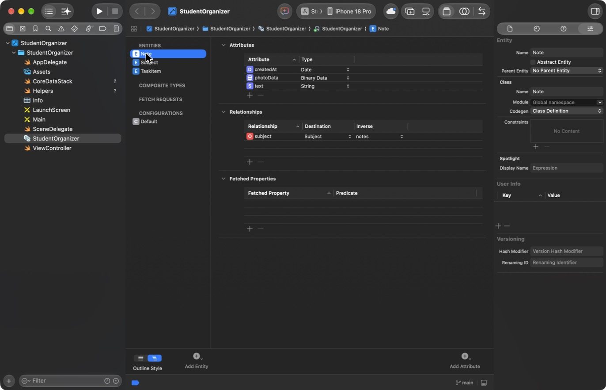
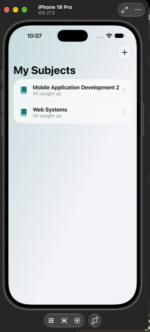
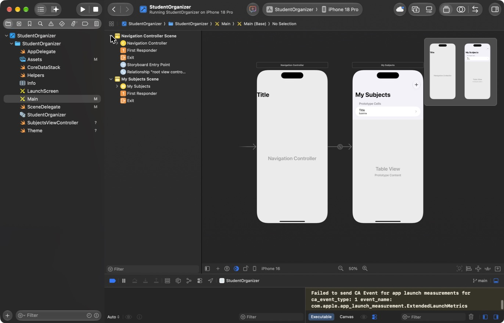
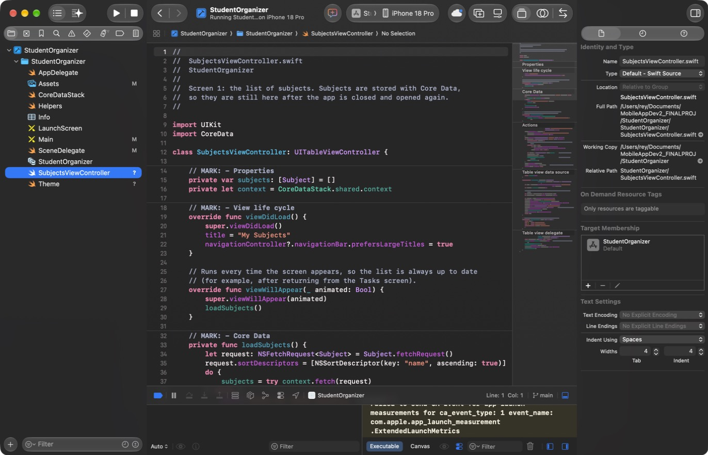

# Student Organizer

IT0093 — Mobile Application Development 2, Course Project
Student: Cezar Rey Ballad · FEU Tech

A storyboard-based UIKit app (Swift) that helps a student keep track of subjects, tasks and photo notes. All data is stored on the device with Core Data, so nothing is lost when the app is closed.

| | |
|---|---|
| Xcode | 27.2 |
| Minimum iOS | 16.0 (iPhone only, portrait) |
| Interface | Storyboard (UIKit), no SwiftUI |
| Storage | Core Data (`NSPersistentContainer`), SQLite on device |
| Bundle ID | `com.ballad.StudentOrganizer` |

## Progress

| Part | Topic | Status | Commit message |
|---|---|---|---|
| A | Project setup, Git, Core Data model | Done | `Part A: project setup and Core Data model` |
| B | Navigation controller and Subjects list | Done | `Part B: navigation controller and subjects list` |
| C | Tasks list and Task Form | Pending | |
| D | Notes grid (UICollectionView) | Pending | |
| E | Note Form and Photo Picker | Pending | |
| F | Note Detail and Delete | Pending | |
| G | Testing and cleanup in the Simulator | Pending | |
| H | Run on a physical iPhone | Pending | |

## Part A — Core Data model

Three entities, generated as Swift classes with **Codegen: Class Definition**.

| Entity | Attribute / relationship | Type | Optional | Notes |
|---|---|---|---|---|
| Subject | name | String | No | |
| | createdAt | Date | No | |
| | tasks | To Many → TaskItem | | Delete rule: Cascade |
| | notes | To Many → Note | | Delete rule: Cascade |
| TaskItem | title | String | No | |
| | details | String | Yes | |
| | dueDate | Date | No | |
| | isDone | Boolean | No | Default NO |
| | priority | Integer 16 | No | Default 1 (0 Low, 1 Medium, 2 High) |
| | subject | To One → Subject | | Inverse: tasks; Nullify |
| Note | text | String | No | |
| | createdAt | Date | No | |
| | photoData | Binary Data | Yes | Allows External Storage |
| | subject | To One → Subject | | Inverse: notes; Nullify |

> **Note about the Graph view (Step 9):** the Graph editor style was removed from Xcode's Core Data model editor in Xcode 14, and Xcode 27.2 only offers the List and Hierarchical outline styles. The model editor screenshots below show each entity in Xcode, and the diagram shows the same relationships as the old graph view.

| Subject | TaskItem | Note |
|---|---|---|
|  |  |  |

Files: `CoreDataStack.swift` (one shared persistent container and its view context), `Helpers.swift` (alert, image resizing, empty-state label).

## Part B — Navigation controller and Subjects list

The Subjects screen is a `UITableViewController` embedded in a `UINavigationController`. Tapping **+** shows a `UIAlertController` with a text field; the new `Subject` is saved with Core Data. Swiping left deletes a subject (the Cascade rule also removes its tasks and notes). The list is reloaded in `viewWillAppear`, so it is always current.

| Subjects list (2 subjects) | After stopping and running again |
|---|---|
|  |  |

### Own design choices

The specification allows our own accent colors and SF Symbols. This app uses:

- A deep teal accent color (`AccentColor` asset, with a lighter teal for dark mode).
- Large navigation titles and an inset-grouped table style.
- `Theme.swift`: a soft accent-colored gradient behind each list (`GlassBackgroundView`), and frosted-glass rows (`UIBackgroundConfiguration` with a blur `visualEffect`) so the gradient shows through.
- The `book.closed.fill` SF Symbol for each subject, and a friendlier pending count ("All caught up", "1 pending task", "3 pending tasks").
- `SceneDelegate` saves the Core Data context when the app goes to the background, as an extra safety net.

## How to run

1. Open `StudentOrganizer.xcodeproj` in Xcode.
2. Choose an iPhone simulator as the run destination.
3. Press **Run** (⌘R).
